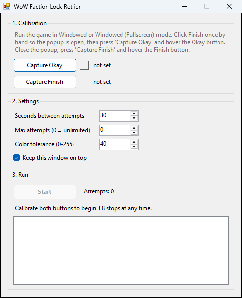

# WoW Faction Lock Retrier

A small Windows app that keeps retrying character creation in World of Warcraft while a faction is locked with this message:

> This faction is currently unavailable on this ruleset due to population imbalance.

It clicks **Finish**. If the popup appears, it clicks **Okay**, waits, and tries again. When the popup stops appearing (meaning the character was probably created), it stops and alerts you.



No installation is needed. There are two versions:

- **`wow-faction-lock-retrier.exe`**: a GUI app (download from [Releases](../../releases))
- **`wow-faction-lock-retrier.ps1`**: a console PowerShell script, if you prefer to run readable source directly

## Files

| File | Description |
|------|-------------|
| `src/WowFactionLockRetrier.cs` | C# source for the GUI exe |
| `build.bat` | Builds the exe with the C# compiler that ships with Windows (no SDK needed) |
| `wow-faction-lock-retrier.ps1` | PowerShell console version |
| `wow-faction-lock-retrier.bat` | Launcher for the PowerShell version |

## How it works

- During calibration you show it where the **Okay** and **Finish** buttons are. It also records the pixel color of the Okay button while the popup is open.
- On each attempt it clicks Finish, then watches that pixel for up to 10 seconds.
  - **Color matches:** the popup is back, so the faction is still locked. It clicks Okay and waits for the configured interval.
  - **Color doesn't match:** the popup didn't appear. It assumes success and stops, so it never clicks blindly on the character select screen.
- **Safety checks:** before every click it makes sure the World of Warcraft window is in front, not minimized, and that no other window covers the Finish/Okay buttons. A minimized game is restored automatically. If WoW can't be brought to the front, the attempt is skipped (and logged) instead of clicking whatever is on screen, and a missing popup is never counted as success unless WoW was visible while it checked.

## Requirements

- Windows 10 or 11 (.NET Framework 4.x and Windows PowerShell 5.1 are built in)
- The game must run in **Windowed** or **Windowed (Fullscreen)** mode. Pixel colors often can't be read in exclusive fullscreen.

## Usage (GUI)

1. Download `wow-faction-lock-retrier.exe` from [Releases](../../releases) and run it.
2. In game, set up your character on the creation screen and click **Finish** once by hand, so the popup stays open.
3. **Calibration** (each capture has a 5-second countdown):
   1. Click **Capture Okay**, then move the mouse to the center of the popup's **Okay** button and leave it there.
   2. Click **Okay** in the game by hand to close the popup.
   3. Click **Capture Finish**, then move the mouse to the center of the **Finish** button.
4. **Settings**: adjust the interval, max attempts and color tolerance if needed.
5. **Run**: click **Start**. To stop, click **Stop** or press **F8** (works even while the game is focused).

When the popup stops appearing, the app beeps, flashes its window and shows a message.

While it runs it controls the mouse, so don't use the PC for anything else. The game can't run fully in the background: if you switch to another window, attempts pause ("Skipped: ...") until WoW is back in front.

| Setting | Default | Description |
|---------|---------|-------------|
| Seconds between attempts | `30` | Wait between attempts |
| Max attempts | `0` | Stop after this many attempts (`0` = unlimited) |
| Color tolerance | `40` | How far a pixel's color may differ per RGB channel (0–255) and still count as a match |
| Keep this window on top | on | Keeps the app visible above the game |

## Usage (PowerShell version)

1. Put `wow-faction-lock-retrier.bat` and `wow-faction-lock-retrier.ps1` in the same folder.
2. Click **Finish** once in game so the popup stays open, then double-click `wow-faction-lock-retrier.bat`.
3. Follow the console prompts (6-second countdown for each button). Press **Ctrl+C** to stop.

Options:

```powershell
powershell -ExecutionPolicy Bypass -File .\wow-faction-lock-retrier.ps1 -IntervalSec 60 -MaxAttempts 200 -Tolerance 40
```

## Building the exe yourself

Run `build.bat`. It compiles `src/WowFactionLockRetrier.cs` with `csc.exe` from the .NET Framework that ships with Windows and writes `wow-faction-lock-retrier.exe` next to it.

## Troubleshooting

- **"The Okay color is still visible" / "same color is read with the popup closed"**: the point you picked looks the same with and without the popup. Recapture Okay on the solid red part of the button.
- **"Skipped: another window is in front of WoW"**: Windows sometimes refuses to bring a window to the front while you're using another app. Click on the game once, and leave the PC alone while it runs.
- **"Skipped: another window covers the button"**: something (often this app's own window, when "Keep this window on top" is on) sits over the Finish or Okay button. Move it aside.
- **"Skipped: WoW window not found"**: the app looks for a window whose title contains "World of Warcraft". Make sure the game is running.
- **It stops right away, but no character was created**: the server may take longer than 10 seconds to respond, or the color check failed. Try windowed mode, recalibrate, or raise the tolerance.
- **It never stops, even after the faction opens**: lower the tolerance and recalibrate.
- **Windows SmartScreen or antivirus warns about the exe**: the exe is unsigned and moves the mouse, which some antivirus heuristics flag. You can read the source and build it yourself with `build.bat`, or use the PowerShell version.
- **Coordinates are wrong**: don't move or resize the game window after calibrating.

## Disclaimer

Blizzard's Terms of Use prohibit third-party programs that automate gameplay. This tool only clicks two buttons on the character creation screen, at a slow interval, but using it is still **at your own risk**. Keep the interval reasonable (30–60 seconds), and don't leave it hammering the server.

This project is not affiliated with or endorsed by Blizzard Entertainment. World of Warcraft is a trademark of Blizzard Entertainment, Inc.

## License

MIT
